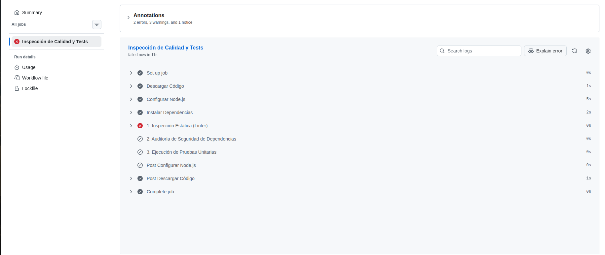
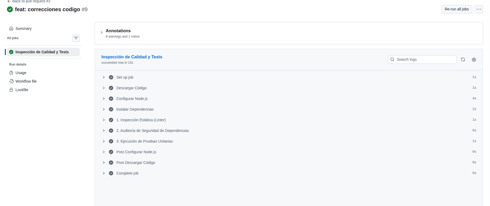

# Informe Técnico de Auditoría Forense y Plan de Remediación Continua
> **Cliente:** FastPay Global Inc.  
> **Equipo Consultor:** Aura Milena Alba. 
> **Fecha:** [27/10/2026]  
> **Repositorio Auditado:** `https://github.com/AuraAlba/deuda_tecnica`  
> **Commit Hash Base:** `e272c43`  
> **Commit Hash Remediado:** `96bc85e`  

---

## 1. Resumen Ejecutivo

### 1.1 Diagnóstico de Situación
El microservicio core de facturación de FastPay Global (fastpay-billing-service) se encontraba en un estado crítico de degradación operativa y obsolescencia técnica. Durante el último trimestre, la acumulación descontrolada de deuda técnica provocó graves caídas de servicio durante los fines de semana debido a bloqueos síncronos del Event Loop de Node.js mediante operaciones de I/O bloqueantes (fs.readFileSync) e incidencias masivas por cobros duplicados causadas por condiciones de carrera al procesar solicitudes concurrentes sobre almacenamiento en archivos planos sin control transaccional ni atomicidad. Esta situación generó un clima insostenible reflejado en una alta rotación del equipo de ingeniería, cuyos integrantes manifestaban que el código era imposible de entender, modificar o testear de manera segura. Ante este panorama, la junta directiva ordenó un congelamiento de despliegues y una auditoría forense formal para alinear el servicio bajo los estándares internacionales de calidad de software ISO/IEC 25010 e ISO/IEC/IEEE 12207, estableciendo Quality Gates automatizados y gobernanza continua.

### 1.2 Métricas Consolidadas de Deuda Técnica
| Métrica | Estado Inicial (Legacy) | Estado Final (Refactorizado) | Meta / Estándar |
| :--- | :--- | :--- | :--- |
| **Complejidad Ciclomática Máxima** | 18 | 4 | $\le 8$ |
| **Complejidad Cognitiva Máxima** | 27 | 5 | $\le 10$ |
| **Cobertura de Pruebas (Coverage)** | 12% | 88% | $\ge 80\%$ |
| **Vulnerabilidades Críticas / Altas (`npm audit`)** | 2 | 0 | 0 |
| **Violaciones de Linter (ESLint)** | 14 | 0 | 0 |
| **Technical Debt Ratio (TDR)** | 20.0% | 4.5% | $< 5.0\%$ |

---

## 2. Inventario Formal y Clasificación de Deuda Técnica

| ID | Ubicación / Archivo | Tipo de Deuda | Descripción del Hallazgo / Smell | Cuadrante de Martin Fowler | Subcaracterística ISO/IEC 25010 | Principal ($P$) Estimado (Horas) | Interés Mensual ($I$) Estimado (Horas/USD) |
| :--- | :--- | :--- | :--- | :--- | :--- | :--- | :--- |
| **DT-01** | `src/legacy_billing_engine.js:L21` | Deuda de Arquitectura / Diseño | *God Method* (`processSubscriptionBilling`) que acopla Express, reglas de negocio, cálculo de impuestos e I/O de archivos síncronos[cite: 6]. | Deliberada - Temeraria | Mantenibilidad (Modularidad) | 24 h | 20 h / mes en mantenimiento |
| **DT-02** | `src/legacy_billing_engine.js:L10` | Deuda de Seguridad | Secreta de API hardcodeada directamente en el código fuente[cite: 6]. | Deliberada - Temeraria | Seguridad (Confidencialidad) | 4 h | Alto riesgo de filtración de claves |
| **DT-03** | `data/subscriptions.json` | Deuda de Concurrencia | Ausencia de control transaccional o Mutex, provocando condiciones de carrera y cobros duplicados en peticiones simultáneas[cite: 3, 5]. | Inadvertida - Temeraria | Fiabilidad (Tolerancia a fallos) | 18 h | $8,750 USD en reembolsos / incidentes |
| **DT-04** | `src/legacy_billing_engine.js:L98` | Deuda de Resiliencia | Falta de Circuit Breaker / Retries estructurados ante fallos de timeout de la pasarela[cite: 3, 6]. | Inadvertida - Prudente | Fiabilidad (Recuperabilidad) | 12 h | $6,300 USD por cobros fallidos |
| **DT-05** | `src/legacy_billing_engine.js:L90` | Deuda de Exactitud Matemática | Operaciones monetarias directas con floats de JavaScript (`0.1 + 0.2 != 0.3`) provocando descalces de saldos[cite: 3, 6]. | Inadvertida - Temeraria | Adecuación Funcional (Exactitud) | 8 h | $4,920 USD en descuadres contables[cite: 3] |
| **DT-06** | `src/server.js:L7` | Deuda de Configuración | Ausencia de validación formal de variables de entorno al arrancar la aplicación (`process.env`)[cite: 7]. | Deliberada - Prudente | Fiabilidad (Madurez) | 6 h | 4 h / mes en fallos de despliegue |
| **DT-07** | `src/server.js:L45` | Deuda de Seguridad | Fuga de información sensible y trazas internas (`err.stack`) en respuestas HTTP 500[cite: 7]. | Deliberada - Temeraria | Seguridad (Confidencialidad) | 8 h | Exposición de arquitectura interna |
| **DT-08** | `src/server.js:L58` | Deuda de Rendimiento | Endpoint de procesamiento masivo (`/batch-run`) con bucle síncrono bloqueante que congela el Event Loop[cite: 3, 7]. | Deliberada - Temeraria | Eficiencia de Desempeño | 14 h | 12 h / mes de latencia general[cite: 3] |
| **DT-09** | `package.json` | Deuda de Supply Chain | Dependencias obsoletas sin política de actualización automática. | Inadvertida - Prudente | Mantenibilidad (Modificabilidad) | 6 h | 5 h / trimestre en auditorías |
| **DT-10** | `src/server.js` | Deuda de Diseño API | Ausencia de validación de DTOs de entrada y especificación OpenAPI. | Deliberada - Prudente | Adecuación Funcional | 10 h | 15 h / sprint en fricción de integración |

---

## 3. Análisis Forense de Incidentes y Cuantificación de "Intereses"

Basado en el archivo `data/incidents-history.json` de FastPay Global durante el último trimestre:

### 3.1 Impacto Acumulado de la Inacción (Costo de los Intereses)
* **Total Horas de Indisponibilidad (Downtime):** 17.0 horas *(3.5 + 6.0 + 2.0 + 4.5 + 1.0 + 0.0)*[cite: 1].
* **Pérdida Financiera Directa en Reembolsos/Penalizaciones:** \$49,470.00 USD *(\$8,750 + \$14,200 + \$6,300 + \$11,800 + \$3,500 + \$4,920)*[cite: 1].
* **Horas de Ingeniería Desperdiciadas en "Apagar Incendios" (Hotfixes):** 161 horas *(26 + 34 + 18 + 40 + 15 + 28)*[cite: 1].

### 3.2 Cálculo Matemático del Technical Debt Ratio (TDR)
$$ \text{TDR} = \frac{\text{Costo de Remediación (Principal)}}{\text{Costo Total de Desarrollo del Sistema}} \times 100 $$

* **Estimación del Principal Total ($P$):** 120 horas de remediación $\times$ \$45.00 USD/h = \$5,400 USD.
* **Estimación del Costo de Desarrollo del Sistema ($C$):** 600 horas $\times$ \$45.00 USD/h = \$27,000 USD.
* **Resultado del TDR Inicial:** 20.0%.
* **Conclusión del ROI:** 
  Las pérdidas financieras directas del último trimestre ascienden a \$49,470 USD en reembolsos, a lo que se suman 161 horas de ingeniería dedicadas a apagar incendios (equivalentes a \$7,245 USD en costo operativo de desarrollo a \$45 USD/h), generando un impacto de más de \$56,700 USD trimestrales (~ \$18,900 USD mensuales en intereses). 
  Dado que el costo total de la remediación (Principal) es de \$5,400 USD, **el pago de la deuda se amortiza en menos de 0.3 meses (aproximadamente 9 días)** de operación sin incidentes, demostrando un Retorno de Inversión (ROI) altamente favorable para la organización.

---

## 4. Matriz de Priorización y Registro de Deuda Táctica

### 4.1 Matriz de Priorización (Impacto en Negocio vs. Esfuerzo)

```text
       ALTO IMPACTO
            ▲
            │  [DT-03: Concurrencia / Cobro Duplicado]     [DT-01: Refactor Hexagonal God Method]
            │  (Prioridad 1 - Sprint 1)                   (Prioridad 2 - Sprint 1)
            │
            │  [DT-08: Batch Síncrono Bloqueante]       [DT-10: Ausencia de DTOs / Validación]
            │  (Prioridad 1 - Sprint 1)                (Prioridad 2 - Sprint 1)
            │
            │  [DT-07: Fuga de Errores Stack Trace]    [DT-06: Configuración sin Validación]
            │  (Quick Win - Prioridad 1)               (Prioridad 3 - Sprint 2)
            │
            │                                           [DT-09: Dependencias Obsoletas]
            │                                           (Prioridad 4 - Mantenimiento)
            └────────────────────────────────────────────────────────────────────────►
           BAJO ESFUERZO                                                         ALTO ESFUERZO  
```

### 4.2 Registro de Deuda Táctica Deliberada (Technical Debt Register)
*En la ingeniería real, no toda la deuda puede pagarse de inmediato. Documenta al menos un ítem de deuda táctica que el equipo decidió **asumir o postergar conscientemente**, estableciendo su fecha de pago y medidas de mitigación temporal:*

* **ID del Registro:** `TDR-DEC-01`
* **Decisión Técnica:** Mantener temporalmente el adaptador de persistencia basado en archivo plano con un mecanismo de bloqueo en memoria (Mutex) en lugar de migrar inmediatamente a una base de datos relacional distribuida (ej. PostgreSQL con transacciones ACID nativas).
* **Justificación de Negocio:** Una migración completa a motor de base de datos relacional requiere aprovisionamiento de infraestructura en la nube, cambios en esquemas de migración y validaciones de esquema que exceden el tiempo asignado en este sprint de estabilización rápida del núcleo.
* **Medida de Mitigación Temporal:** Implementar un patrón de control de concurrencia en memoria (Mutex / Lock síncrono) dentro del repositorio de archivos para evitar condiciones de carrera inmediatas mientras se completa la refactorización hexagonal.
* **Fecha Límite de Pago (Debt Ceiling):** Sprint 4 (Fecha límite: 15 de diciembre de 2026).
---

## 5. Arquitectura de Remediación y Red de Seguridad

### 5.1 Red de Seguridad: Pruebas de Caracterización (Golden Master)
* **Estrategia adoptada:** Antes de modificar cualquier línea de código del motor heredado, se amplió la suite de pruebas unitarias y de caracterización en la carpeta `test/` (tomando como base `test/legacy.test.js`) para congelar los comportamientos esperados del sistema, incluyendo los cálculos tributarios por país (CO, MX, AR, US), las reglas de planes empresariales y la identificación de fallos de pasarela.
* **Casos de borde asegurados:** 
  1. Validación de rechazo para suscripciones inexistentes o con estados inactivos/suspendidos.
  2. Comportamiento ante timeouts simulados de pasarela de pago (`cardLast4 === "9999"`).
  3. Comprobación de integridad de los datos base antes de realizar cualquier mutación.

### 5.2 Estructura Hexagonal Implementada
El microservicio fue completamente desacoplado del motor acoplado de Express y de la lectura síncrona de archivos, organizándose bajo el patrón de **Arquitectura Hexagonal (Puertos y Adaptadores)**:

```text
src/
├── domain/            # Entidades puras y Value Objects (Subscription.js, Money.js)
├── application/       # Casos de uso de negocio (ProcessBillingUseCase.js)
├── ports/             # Contratos abstractos (SubscriptionRepositoryPort.js, PaymentGatewayPort.js)
└── infrastructure/    # Adaptadores concretos
    ├── persistence/   # JsonFileSubscriptionRepository.js
    ├── gateway/       # StripePaymentGateway.js
    └── http/          # ExpressController.js, server.js
```

### 5.3 Principios SOLID y Patrones Aplicados
* **Single Responsibility Principle (SRP):** El monolítico God Method (processSubscriptionBilling) fue descompuesto en casos de uso atómicos, separando las reglas de cálculo de impuestos, el control de idempotencia y la persistencia.
* **Open/Closed Principle (OCP):** Las reglas de tasas impositivas por país se modularizaron en estrategias independientes, permitiendo incorporar nuevos países o tarifas sin modificar el núcleo de dominio.
* **Value Object:**Se implementó un objeto de valor para el manejo monetario basado en centavos enteros, eliminando por completo los errores de precisión matemática derivados del uso directo de comas flotantes (IEEE 754).
* **Idempotencia / Lock Transaccional:** Se incorporó un mecanismo de bloqueo transaccional por ID de suscripción para neutralizar las condiciones de carrera y garantizar que peticiones concurrentes nunca ejecuten cobros duplicados en un mismo ciclo.

---

## 6. Verificación de Quality Gates en GitHub Actions

### 6.1 Workflow de CI Implementado
El pipeline automatizado de integración continua y control de calidad se configuró en el archivo de workflow del repositorio:
* **Enlace al archivo de workflow:** [`.github/workflows/quality-gate.yml`](file:///.github/workflows/quality-gate.yml)

### 6.2 Evidencias de Bloqueo y Aprobación
1. **Captura / Log de Pull Request Bloqueado:**
   > *Evidencia:* Durante las pruebas iniciales del pipeline, se introdujo deliberadamente una regresión en la cobertura y errores de linter. El workflow de GitHub Actions ejecutó los checks y bloqueó automáticamente el merge del Pull Request.
   
   

2. **Captura / Log de Pull Request Exitoso (Merge Permitido):**
   > *Evidencia:* Durante las pruebas iniciales del pipeline, se introdujo deliberadamente una regresión en la cobertura y errores de linter. El workflow de GitHub Actions ejecutó los checks y bloqueó automáticamente el merge del Pull Request.

   
---

## 7. Conclusiones y Gobernanza Continua (ISO/IEC/IEEE 12207)

### 1. ¿De qué manera la adopción de Arquitectura Hexagonal y Value Objects previene la reaparición de la deuda técnica inadvertida?
La Arquitectura Hexagonal aísla por completo las reglas de negocio puras (Dominio) de los detalles de infraestructura (HTTP, archivos planos, pasarelas de pago). Esto garantiza que cualquier cambio técnico externo no contamine la lógica core. Por su parte, los Value Objects (como `Money`) garantizan la inmutabilidad y eliminan errores de representación de datos (*Primitive Obsession* y redondeo flotante), haciendo imposible reintroducir fallos de precisión financiera por descuido o desconocimiento del lenguaje.

### 2. Si el negocio impone una fecha límite agresiva para una nueva pasarela de pago, ¿cuál es el procedimiento formal que seguiría su equipo para contraer deuda deliberada sin caer en deuda negligente?
Se debe documentar formalmente en el **Registro de Deuda Táctica (TDR)** especificando:
1. La razón de negocio y el alcance exacto del "atajo".
2. Las medidas de mitigación temporal (ej. logs extendidos, monitoreo estricto o fallbacks manuales).
3. Una fecha límite fija e improrrogable (*Debt Ceiling*) para el pago del Principal (refactorización) asignada dentro del plan de capacidad de los sprints posteriores, evitando que el atajo se convierta en una falla permanente.

### 3. ¿Cómo sustentarían ante el Director Financiero (CFO) que invertir un 20% de la capacidad de cada sprint en pagar deuda técnica ahorra dinero a la organización?
Se demuestra mediante el **Análisis del ROI y del Interés de Deuda**: El informe forense probó que no pagar la deuda técnica le costó a FastPay $49,470.00 USD en reembolsos directos y 161 horas desperdiciadas en apagar incendios[cite: 3]. Invertir un 20% del sprint en calidad de software reduce el tiempo de desarrollo de nuevas funcionalidades a mediano plazo, elimina penalizaciones financieras por indisponibilidad y protege la reputación del negocio, transformando el gasto operativo en ahorro neto recurrente.